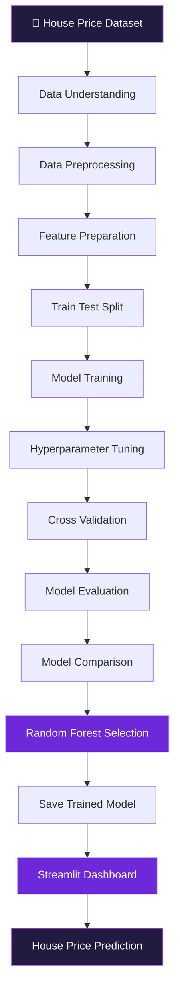
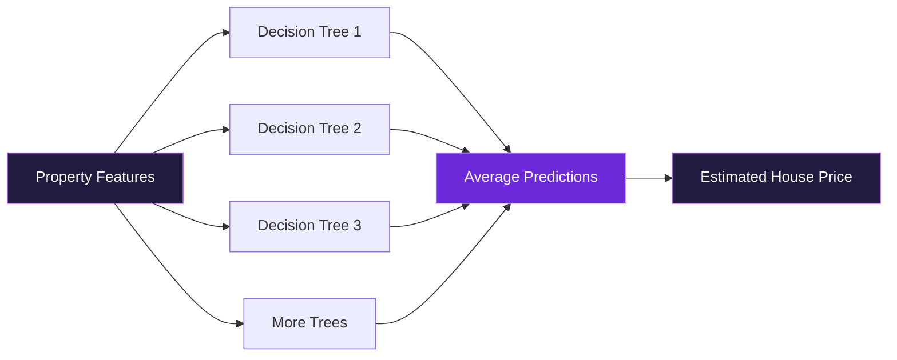

# 🏡 HOUSE PRICE PREDICTION

### ✨ AI-Powered Real Estate Price Estimation

\<p align="center">

&#x20; \   \   \   \

\</p>

\<p align="center">   \<b>A Machine Learning Regression Project for Predicting House Prices\</b>   \<br/>   Built with Python, Scikit-learn and Streamlit \</p>

---

## 🚀 QUICK ACCESS

\<p align="center">


\</p>

> 💜 **LOCAL APP:** [http://localhost:8501](http://localhost:8501)
> Run the Streamlit application first to open this link. It works on the computer where the app is running.

---

## 📌 PROJECT OVERVIEW

House Price Prediction is a Machine Learning project that estimates property prices based on different property and location-related features.

The project uses supervised learning regression algorithms to understand the relationship between property characteristics and their selling prices.

The final selected model in this project is **Random Forest Regression**.

### 🎯 Project Objectives

- Understand and prepare real estate data.
- Perform data preprocessing.
- Train different regression algorithms.
- Apply hyperparameter tuning.
- Evaluate and compare machine learning models.
- Identify overfitting and underfitting.
- Save the best-performing model.
- Develop an interactive Streamlit web application.

---

## 📊 PROJECT DASHBOARD

| Project Information  | Details                |
| :------------------- | :--------------------- |
| Project Name         | House Price Prediction |
| Domain               | Machine Learning       |
| Learning Type        | Supervised Learning    |
| Problem Type         | Regression             |
| Dataset Records      | 3,800                  |
| Input Features       | 11                     |
| Training Records     | 3,040                  |
| Testing Records      | 760                    |
| Selected Model       | Random Forest          |
| Deployment Framework | Streamlit              |
| Programming Language | Python                 |

---

## 🧠 MACHINE LEARNING WORKFLOW



---

## 📂 DATASET INFORMATION

The dataset contains property-related information used to predict house prices.

### Features Description

| Feature            | Description                   |
| :----------------- | :---------------------------- |
| `property_id`      | Unique property identifier    |
| `sale_date`        | Property sale date            |
| `area_sqft`        | Property area in square feet  |
| `bedrooms`         | Number of bedrooms            |
| `bathrooms`        | Number of bathrooms           |
| `location_score`   | Location quality score        |
| `property_age`     | Age of the property           |
| `distance_city_km` | Distance from city            |
| `near_school`      | School availability indicator |
| `near_metro`       | Metro availability indicator  |
| `crime_rate_index` | Area crime rate index         |
| `house_price_inr`  | Target variable               |

**Target Variable:** `house_price_inr`

---

## ⚙️ PROJECT TASKS (1–26)

| Part   | Topics Covered                                                |
| :----- | :------------------------------------------------------------ |
| Part A | Data Understanding and Preparation                            |
| Part B | Feature Selection and Train-Test Split                        |
| Part C | Ridge, Lasso and Hyperparameter Tuning                        |
| Part D | K-Fold, Stratified K-Fold, LOOCV and Time Series Split        |
| Part E | Decision Tree and Random Forest                               |
| Part F | Linear SVR, RBF SVR and SVR Tuning                            |
| Part G | Evaluation Metrics, Model Comparison and Overfitting Analysis |
| Part H | Final Model, Report and Submission                            |

### Algorithms Used

| Algorithm        | Purpose                             |
| :--------------- | :---------------------------------- |
| Ridge Regression | L2 Regularization                   |
| Lasso Regression | L1 Regularization                   |
| Decision Tree    | Tree-Based Regression               |
| Random Forest    | Ensemble Learning                   |
| Linear SVR       | Linear Support Vector Regression    |
| RBF SVR          | Nonlinear Support Vector Regression |

---

## 📈 MODEL EVALUATION

The project uses the following regression evaluation metrics:

| Metric      | Meaning                 | Better Result |
| :---------- | :---------------------- | :------------ |
| MAE         | Mean Absolute Error     | Lower         |
| MSE         | Mean Squared Error      | Lower         |
| RMSE        | Root Mean Squared Error | Lower         |
| R² Score    | Explained Variance      | Higher        |
| Adjusted R² | Adjusted Model Fit      | Higher        |

### Model Comparison

The models are compared using their training, validation and testing performance.

| Model            |     MAE    |    RMSE    |  R² Score  |
| :--------------- | :--------: | :--------: | :--------: |
| Ridge Regression | Add result | Add result | Add result |
| Lasso Regression | Add result | Add result | Add result |
| Decision Tree    | Add result | Add result | Add result |
| Random Forest    | Add result | Add result | Add result |
| Linear SVR       | Add result | Add result | Add result |
| RBF SVR          | Add result | Add result | Add result |

> Note: Enter the actual values from your notebook's evaluation results. No performance values are assumed here.

---

## 🌲 SELECTED MODEL — RANDOM FOREST

Random Forest Regression is an ensemble learning algorithm that combines multiple Decision Trees to produce a final prediction.

### Why Random Forest?

- Learns complex relationships in data.
- Can capture nonlinear patterns.
- Combines predictions from multiple trees.
- Reduces the instability of a single decision tree.
- Useful for regression problems.

### Model Prediction Process



---

## 💻 STREAMLIT WEB APPLICATION

The project includes a professional Streamlit dashboard with a premium dark purple and violet theme.

### Application Features

| Feature            | Description                                 |
| :----------------- | :------------------------------------------ |
| Dashboard          | Project overview and model details          |
| Predict Price      | Enter property information                  |
| Price Estimation   | Display predicted house price               |
| Prediction History | View predictions during the current session |
| About Model        | View model and feature information          |
| Responsive Layout  | Wide dashboard interface                    |

### App Theme

- Midnight Navy Background
- Purple and Violet Gradient
- Glass-Style Metric Cards
- Modern Input Fields
- Premium Prediction Button

### Application Preview

> Open the app locally: [http://localhost:8501](http://localhost:8501)

---

## 🗂️ PROJECT STRUCTURE

```text
House-Price-Prediction/
│
├── Analysis/
│   └── analysis.ipynb
│
├── App/
│   ├── app.py
│   └── requirements.txt
│
├── Dataset/
│
├── Evaluation plots/
│
├── Model/
│   └── best_house_price_model.pkl
│
└── README.md
```

---

## 🛠️ TECHNOLOGIES USED

| Technology       | Usage                     |
| :--------------- | :------------------------ |
| Python           | Main Programming Language |
| Pandas           | Data Manipulation         |
| NumPy            | Numerical Operations      |
| Scikit-learn     | Machine Learning          |
| Matplotlib       | Data Visualization        |
| Seaborn          | Statistical Visualization |
| Joblib           | Model Saving              |
| Streamlit        | Web Application           |
| VS Code          | Development Environment   |
| Jupyter Notebook | Model Development         |

---

## ▶️ HOW TO RUN THE PROJECT

### Step 1 — Clone the Repository

```bash
git clone YOUR_GITHUB_REPOSITORY_URL
```

### Step 2 — Open Project Folder

```bash
cd House-Price-Prediction
```

### Step 3 — Install Dependencies

```bash
pip install -r App/requirements.txt
```

### Step 4 — Run Streamlit Application

```bash
streamlit run App/app.py
```

### Step 5 — Open the Application


**Local URL:** [http://localhost:8501](http://localhost:8501)

---

## 🌐 PUBLIC DEPLOYMENT

The application can be deployed using Streamlit Community Cloud.

1. Upload the project to a GitHub repository.
2. Make sure the `App` and `Model` folders are included.
3. Connect your GitHub repository to Streamlit Community Cloud.
4. Select `App/app.py` as the main application file.
5. Deploy the application.

**Deployment Platform:** [Streamlit Community Cloud](https://share.streamlit.io/)

> Important: The public deployment needs the saved model file and all required dependencies. Do not share the localhost address as a public website link.

---

## 📊 PROJECT VISUALIZATIONS

The `Evaluation plots/` folder contains the visual outputs generated during the project.

Add your actual plot images below using their exact filenames:

| Visualization       | Purpose                           |
| :------------------ | :-------------------------------- |
| Model Comparison    | Compare regression models         |
| Actual vs Predicted | Understand prediction performance |
| Residual Plot       | Analyze prediction errors         |
| Feature Importance  | Understand influential features   |
| Error Distribution  | Study model error patterns        |

Example Markdown image syntax:

```markdown

```

---

## 🎓 LEARNING OUTCOMES

Through this project, I learned:

- Fundamentals of supervised machine learning.
- Regression algorithms and their applications.
- Data preprocessing and feature preparation.
- Cross-validation techniques.
- Hyperparameter optimization.
- Model evaluation and comparison.
- Overfitting and underfitting analysis.
- Saving and reusing trained machine-learning models.
- Building interactive applications using Streamlit.

---

## 🔮 FUTURE IMPROVEMENTS

- Add more real estate data.
- Improve prediction accuracy through further experimentation.
- Add interactive charts and property analytics.
- Add downloadable prediction reports.
- Add location-based property comparisons.
- Deploy the application with a public URL.

---

## 👩‍💻 PROJECT DETAILS

| Field     | Information                                |
| :-------- | :----------------------------------------- |
| Project   | House Price Prediction                     |
| Domain    | Artificial Intelligence & Machine Learning |
| Model     | Random Forest Regression                   |
| Interface | Streamlit Dashboard                        |
| Language  | Python                                     |
| Status    | Model Saved & App Created                  |

---

\<p align="center">

### 💜 THANK YOU FOR VISITING!

**HOUSE PRICE PREDICTION**

*Turning Property Data into Smart Price Estimates.*

Built with Python • Machine Learning • Streamlit

\</p>

\<p align="center">   \   \ \</p>
