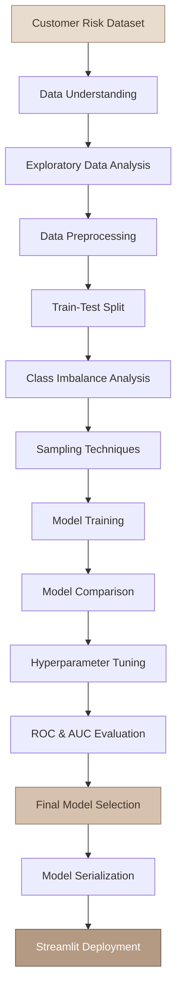

# ✦ CUSTOMER RISK CLASSIFICATION SYSTEM

### Machine Learning | Imbalanced Data Handling | Model Optimization | Streamlit

<p align="center">


**An Intelligent Customer Risk Prediction & Classification System**

*Turning customer data into meaningful risk insights through Machine Learning.*

</p>

---

<p align="center">

## ✦ PROJECT FILE — QUICK ACCESS ✦

<a href="https://drive.google.com/file/d/1hdc1m5FLfhBX-S--B2CwPoffQx7kcAUX/view?usp=sharing">


</a>

### 📂 [CLICK HERE TO OPEN MY COMPLETE PROJECT](https://drive.google.com/file/d/1hdc1m5FLfhBX-S--B2CwPoffQx7kcAUX/view?usp=sharing)

*Access the complete project through Google Drive.*

</p>

---

## ◈ 01. Project Overview

The **Customer Risk Classification System** is a Machine Learning project designed to classify customers into different risk categories using classification algorithms.

The project focuses on developing reliable predictive models, handling imbalanced datasets, optimizing model performance and evaluating classification results through statistical metrics.

An interactive **Streamlit application** is also developed to allow users to enter customer information and receive risk predictions.

### ✦ Project Highlights

| Component | Description |
|:---|:---|
| Project Type | Supervised Machine Learning |
| Learning Task | Binary Classification |
| Dataset | Customer Risk Classification Dataset |
| Primary Objective | Low Risk vs High Risk Prediction |
| Imbalance Handling | Under-Sampling, Over-Sampling, SMOTE, ADASYN |
| Model Optimization | RandomizedSearchCV & GridSearchCV |
| Model Evaluation | Confusion Matrix, ROC, AUC-ROC |
| Deployment | Streamlit Web Application |

---

## ◈ 02. Project Objectives

- Develop classification models for customer risk prediction.
- Analyze and understand class imbalance.
- Apply different sampling techniques.
- Compare multiple classification algorithms.
- Optimize model hyperparameters.
- Evaluate models using multiple performance metrics.
- Minimize False Negative errors.
- Deploy the selected model through an interactive web application.

---

## ◈ 03. Technology Stack

| Technology | Purpose |
|:---|:---|
| Python | Core Programming |
| Pandas | Data Manipulation |
| NumPy | Numerical Computation |
| Matplotlib | Data Visualization |
| Seaborn | Statistical Visualization |
| Scikit-learn | Machine Learning |
| Imbalanced-learn | Imbalanced Data Handling |
| Joblib | Model Serialization |
| Streamlit | Interactive Application |
| Jupyter Notebook | Development Environment |

---

## ◈ 04. Machine Learning Workflow



---

## ◈ 05. Project Structure

```text
Project 3/
│
├── analysis/
│   └── analysis.ipynb
│
├── app/
│   └── app.py
│
├── Dataset/
│   └── Risk_Alert_Classifier_Dataset_4600.csv
│
├── Final_Output/
│   ├── All_Plots/
│   │   ├── Plot_001.png
│   │   ├── Plot_002.png
│   │   └── ...
│   │
│   ├── final_risk_model.pkl
│   ├── final_model_comparison.csv
│   ├── imbalance_impact.csv
│   ├── auc_roc_comparison.csv
│   └── final_predictions.csv
│
└── README.md
```

---

## ◈ 06. Exploratory Data Analysis

Exploratory Data Analysis is performed to understand the dataset, identify patterns, analyze feature distributions and understand the target class distribution.

### Analysis Includes

- Dataset structure and information
- Statistical summary
- Missing value analysis
- Duplicate value analysis
- Feature distributions
- Correlation analysis
- Target class distribution
- Outlier analysis

---

## ◈ 07. Class Imbalance Handling

Class imbalance can affect classification performance, especially when the model needs to identify a minority class.

The following techniques are implemented:

| Technique | Purpose |
|:---|:---|
| Under-Sampling | Reduces majority class observations |
| Over-Sampling | Increases minority class observations |
| SMOTE | Generates synthetic minority observations |
| ADASYN | Generates adaptive synthetic observations |

The models are compared to understand how different balancing techniques affect Recall, Precision, F1-Score and AUC-ROC.

---

## ◈ 08. Classification Models

The following classification models and techniques are explored:

| Model | Description |
|:---|:---|
| Logistic Regression | Linear classification algorithm |
| Decision Tree | Tree-based classification |
| Random Forest | Ensemble learning algorithm |
| Balanced Classifiers | Models trained using sampling techniques |
| Tuned Decision Tree | Hyperparameter-optimized classifier |
| Tuned Random Forest | Hyperparameter-optimized classifier |

### Hyperparameter Optimization

- RandomizedSearchCV
- GridSearchCV
- Cross-validation
- F1-Score-based model selection

---

## ◈ 09. Model Evaluation Dashboard

The project evaluates classification models using multiple performance metrics.

| Metric | Meaning |
|:---|:---|
| Accuracy | Overall correct predictions |
| Precision | Correct positive predictions |
| Recall | Identified positive observations |
| F1-Score | Balance between Precision and Recall |
| AUC-ROC | Ability to distinguish between classes |
| False Positive | Low Risk predicted as High Risk |
| False Negative | High Risk predicted as Low Risk |

### Performance Comparison

The final model comparison is generated from the actual evaluation results.

| Model | Accuracy | Precision | Recall | F1-Score | AUC-ROC |
|:---|:---:|:---:|:---:|:---:|:---:|
| Logistic Regression | — | — | — | — | — |
| Decision Tree | — | — | — | — | — |
| Random Forest | — | — | — | — | — |
| Balanced Models | — | — | — | — | — |
| Tuned Model | — | — | — | — | — |

*Actual evaluation scores are available in `Final_Output/final_model_comparison.csv`. Values are intentionally not fabricated.*

### ◇ ROC Curve Analysis

ROC curves are used to compare the True Positive Rate against the False Positive Rate.


### ◇ Model Performance Visualization


### ◇ Confusion Matrix

The confusion matrix helps understand correct predictions and classification errors.

*Additional evaluation plots are available in the `Final_Output/All_Plots/` folder.*

---

## ◈ 10. Business Interpretation

The business objective is to identify High Risk customers while minimizing incorrect Low Risk predictions.

### False Positive (FP)

A Low Risk customer is incorrectly classified as High Risk.

**Business Impact:**

- Unnecessary verification.
- Additional operational costs.
- Inconvenience to genuine customers.

### False Negative (FN)

A High Risk customer is incorrectly classified as Low Risk.

**Business Impact:**

- Risky customers may remain unidentified.
- Potential financial losses.
- Increased business exposure.

**Business Priority:** Minimizing False Negative errors is particularly important when identifying High Risk customers.

---

## ◈ 11. Interactive Streamlit Application

The project includes an interactive web application built using Streamlit.

### Application Features

- Customer information input.
- Dynamic feature-based input fields.
- Selected classification model information.
- Low Risk probability.
- High Risk probability.
- Adjustable classification threshold.
- Instant prediction results.

### Run Application Locally

**Step 1 — Install Dependencies**

```bash
python -m pip install pandas numpy matplotlib seaborn scikit-learn imbalanced-learn streamlit joblib
```

**Step 2 — Open Project Directory**

```bash
cd "D:\Supervised Learning\Projects\Project 3"
```

**Step 3 — Run Streamlit**

```bash
streamlit run app/app.py
```

### Application Access

<p align="center">

<a href="http://localhost:8501">


</a>

**Local URL:** http://localhost:8501

</p>

*The application is accessible locally when the Streamlit server is running.*

---

## ◈ 12. Final Deliverables

| Deliverable | File |
|:---|:---|
| Source Code | `analysis/analysis.ipynb` |
| Streamlit Application | `app/app.py` |
| Trained Model | `Final_Output/final_risk_model.pkl` |
| Model Comparison | `final_model_comparison.csv` |
| Imbalance Analysis | `imbalance_impact.csv` |
| AUC-ROC Results | `auc_roc_comparison.csv` |
| Final Predictions | `final_predictions.csv` |
| Evaluation Visualizations | `Final_Output/All_Plots/` |

---

## ◈ 13. Final Conclusions

This project demonstrates the complete Machine Learning classification workflow, from dataset understanding and preprocessing to model optimization and deployment.

Different classification algorithms and imbalance handling techniques are evaluated to understand their impact on predictive performance.

Hyperparameter optimization is performed using RandomizedSearchCV and GridSearchCV.

ROC curves, AUC-ROC scores and confusion matrices are used to evaluate the trained models. The final model is selected with particular attention to reducing False Negative errors.

Finally, the selected model is integrated into an interactive Streamlit application for customer risk prediction.

### Future Improvements

- Advanced feature engineering.
- Threshold optimization using validation data.
- Continuous model monitoring.
- Improved prediction explainability.
- Cloud-based application deployment.
- Model performance monitoring on new data.

---

<p align="center">

## ✦ PROJECT 3 — COMPLETED ✦

### CUSTOMER RISK CLASSIFICATION SYSTEM

*Data • Intelligence • Prediction*

---

<sub>Developed using Python, Machine Learning and Streamlit.</sub>

<sub>© 2026 | Machine Learning Project</sub>

</p>