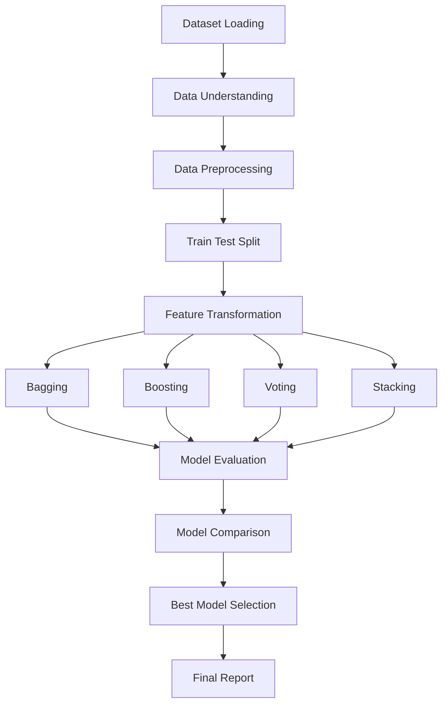

# 🤎 Smart Outcome Predictor
### An Ensemble Machine Learning Project for Student Performance Prediction

<p align="center">


**Predicting Student Completion Status & Final Scores Using Ensemble Learning**

</p>

---


### 📂 [CLICK HERE TO OPEN MY COMPLETE PROJECT VIDEO](https://drive.google.com/file/d/1P4ay149cyRxNEyj2-aNIuTpeuvDsxRCP/view?usp=sharing)

*Access the complete project through Google Drive.*


## 📌 1. Project Overview

**Smart Outcome Predictor** is a Machine Learning project designed to analyze student learning activities and predict their academic outcomes using Ensemble Learning techniques.

The project uses student-related information such as attendance, quiz scores, assignments, study time and learning activities to build predictive models.

It focuses on two major prediction tasks:

- **Classification:** Predict whether a student will complete the course.
- **Regression:** Predict the student's final score.

The main objective is to compare different ensemble algorithms and identify the most suitable models for student outcome prediction.

---

## 🎯 2. Project Objectives

- Understand and implement Ensemble Learning techniques.
- Apply Bagging and Boosting algorithms.
- Implement Voting and Stacking methods.
- Compare different classification and regression models.
- Evaluate models using appropriate performance metrics.
- Identify the best-performing model for each prediction task.
- Generate meaningful visualizations and evaluation reports.

---

## 📂 3. Dataset Information

The project uses the **Smart Outcome Predictor Dataset**.

| Dataset Information | Details |
|---|---|
| Dataset Name | Smart_Outcome_Predictor_Dataset_5200.xlsx |
| Total Records | 5,200 |
| Total Features | 19 |
| File Format | Excel |
| Classification Target | `completion_status` |
| Regression Target | `final_score` |

### Important Dataset Features

| Feature | Description |
|---|---|
| age | Student age |
| country_region | Student region |
| device_type | Learning device |
| education_background | Educational background |
| course_level | Course difficulty level |
| course_category | Course category |
| sessions | Number of learning sessions |
| time_spent_hours | Total learning time |
| videos_watched | Videos watched |
| quiz_attempts | Number of quiz attempts |
| assignments_submitted | Submitted assignments |
| forum_posts | Forum participation |
| avg_quiz_score | Average quiz score |
| attendance_rate | Attendance percentage |
| completion_status | Course completion status |
| final_score | Final academic score |

---

## 🛠️ 4. Technologies & Libraries

| Technology | Purpose |
|---|---|
| Python | Programming language |
| Pandas | Data manipulation |
| NumPy | Numerical operations |
| Matplotlib | Data visualization |
| Seaborn | Statistical visualization |
| Scikit-learn | Machine Learning |
| XGBoost | Gradient Boosting |
| Joblib | Model saving |

### Main Libraries

```python
import os
import warnings
import numpy as np
import pandas as pd
import matplotlib.pyplot as plt
import seaborn as sns
import joblib

from sklearn.model_selection import train_test_split
from sklearn.preprocessing import StandardScaler, OneHotEncoder
from sklearn.compose import ColumnTransformer
from sklearn.pipeline import Pipeline
from sklearn.impute import SimpleImputer

from sklearn.ensemble import (
    BaggingClassifier,
    BaggingRegressor,
    AdaBoostClassifier,
    AdaBoostRegressor,
    VotingClassifier,
    StackingClassifier,
    StackingRegressor
)

from sklearn.metrics import (
    accuracy_score,
    precision_score,
    recall_score,
    f1_score,
    roc_auc_score,
    mean_absolute_error,
    mean_squared_error,
    r2_score
)

from xgboost import XGBClassifier, XGBRegressor
```

---

## 🧠 5. Machine Learning Algorithms

This project implements five major ensemble learning approaches.

### 1. Bagging

Bagging (Bootstrap Aggregating) trains multiple models independently using different samples of the training dataset.

**Implemented Models:**
- Bagging Classifier
- Bagging Regressor

**Benefits:**
- Reduces variance.
- Improves model stability.
- Helps control overfitting.

### 2. Boosting

Boosting trains models sequentially, focusing on improving previous model errors.

**Implemented Algorithms:**

| Algorithm | Description |
|---|---|
| AdaBoost | Gives more importance to incorrectly predicted samples |
| XGBoost | Optimized gradient boosting algorithm with regularization |

**Benefits:**
- Improves predictive performance.
- Combines multiple weak learners.
- Learns complex patterns.

### 3. Voting Ensemble

Voting combines predictions from multiple classification models.

**Types:**

- Hard Voting – Selects the class with the majority of votes.
- Soft Voting – Selects the class with the highest average predicted probability.

### 4. Stacking Ensemble

Stacking combines multiple base models using a meta-learner.

**Implemented Models:**
- Stacking Classifier with Logistic Regression.
- Stacking Regressor with Ridge Regression.

**Benefits:**
- Combines different model strengths.
- Uses a meta-learner for final predictions.
- Can improve prediction performance.

---

## ⚙️ 6. Project Workflow



### Workflow Steps

1. Load the student dataset.
2. Explore dataset features and target variables.
3. Handle missing values.
4. Separate classification and regression targets.
5. Split data into training and testing sets.
6. Apply preprocessing techniques.
7. Train ensemble models.
8. Evaluate model performance.
9. Compare all ensemble techniques.
10. Identify the best models and prepare the final report.

---

## 📊 7. Model Evaluation

Different evaluation metrics are used for classification and regression tasks.

### Classification Metrics

| Metric | Purpose |
|---|---|
| Accuracy | Measures overall correct predictions |
| Precision | Measures correct positive predictions |
| Recall | Measures identified positive cases |
| F1-Score | Balances Precision and Recall |
| ROC-AUC | Measures classification performance across thresholds |

### Regression Metrics

| Metric | Purpose |
|---|---|
| MAE | Mean Absolute Error |
| RMSE | Root Mean Squared Error |
| R² Score | Explains the variance captured by the model |

### Model Selection

- Classification: Highest ROC-AUC score.
- Regression: Lowest RMSE value.

The final model selection is based on the actual evaluation results generated by the notebook.

---

## 📈 8. Visualizations & Reports

The project includes multiple visualizations to understand and compare model performance.

### Classification Analysis

- Classification Model Comparison
- Hard Voting vs Soft Voting
- Voting vs Stacking
- ROC Curves
- Classification Metrics Comparison
- Best Classification Model

### Regression Analysis

- Regression Model Comparison
- Stacking Regressor Performance
- MAE and RMSE Comparison
- R² Score Comparison
- Best Regression Model

All generated plots are organized inside the `All plots` folder.

---

## 📁 9. Project Structure

```text
Smart Outcome Predictor/
│
├── Dataset/
│   └── Smart_Outcome_Predictor_Dataset_5200.xlsx
│
├── Analysis/
│   └── Smart_Outcome_Predictor.ipynb
│
├── All plots/
│   ├── Classification_Results/
│   ├── Regression_Results/
│   ├── Voting_Comparison/
│   ├── Stacking_Results/
│   └── Final_Model_Comparison/
│
├── README.md
└── requirements.txt
```

*Note: Folder names above represent the suggested project organization.*

---

## 🚀 10. Installation & Execution

### Step 1: Clone the Repository

```bash
git clone YOUR_GITHUB_REPOSITORY_URL
```

### Step 2: Open Project Folder

```bash
cd Smart-Outcome-Predictor
```

### Step 3: Install Required Libraries

```bash
pip install numpy pandas matplotlib seaborn scikit-learn xgboost joblib openpyxl jupyter
```

### Step 4: Launch Jupyter Notebook

```bash
jupyter notebook
```

### Step 5: Run the Project

Open the project notebook and execute the cells in sequential order.

**Important:** Keep the dataset in the correct folder so that the notebook can access it.

---

## 🏆 11. Final Project Outcomes

This project demonstrates how different ensemble learning techniques can be applied to student performance prediction.

The final analysis identifies:

- The best classification model for course completion prediction.
- The best regression model for final score prediction.
- The performance differences between Bagging and Boosting.
- The advantages of Voting and Stacking.
- The potential application of predictive analytics in educational systems.

### Final Model Results

| Prediction Task | Best Model | Selection Metric |
|---|---|---|
| Classification | Check notebook results | Highest ROC-AUC |
| Regression | Check notebook results | Lowest RMSE |

---

## 💡 12. Future Improvements

- Build an interactive student prediction dashboard.
- Deploy the selected models using Streamlit.
- Add more student learning activity features.
- Monitor model performance on new student data.
- Improve model tuning and prediction reliability.

---

## 👩‍💻 13. Project Learning Outcomes

Through this project, I gained practical experience in:

- Ensemble Machine Learning.
- Classification and Regression.
- Model Training and Evaluation.
- Feature Preprocessing.
- Performance Comparison.
- Data Visualization.
- Jupyter Notebook Project Development.

---

## 🤎 14. Final Conclusion

The **Smart Outcome Predictor** project demonstrates the practical application of Ensemble Machine Learning for predicting student academic outcomes.

By implementing Bagging, AdaBoost, XGBoost, Voting and Stacking, the project provides a comparative understanding of different ensemble approaches.

The evaluation process helps identify suitable classification and regression models for student outcome prediction.

**This project represents practical learning, experimentation and application of Machine Learning concepts to a real-world educational problem.**

---

<p align="center">

### 🤎 Made with Python & Machine Learning

**Smart Outcome Predictor | Ensemble Learning Project**

*Turning Student Data into Meaningful Predictions.*

</p>
